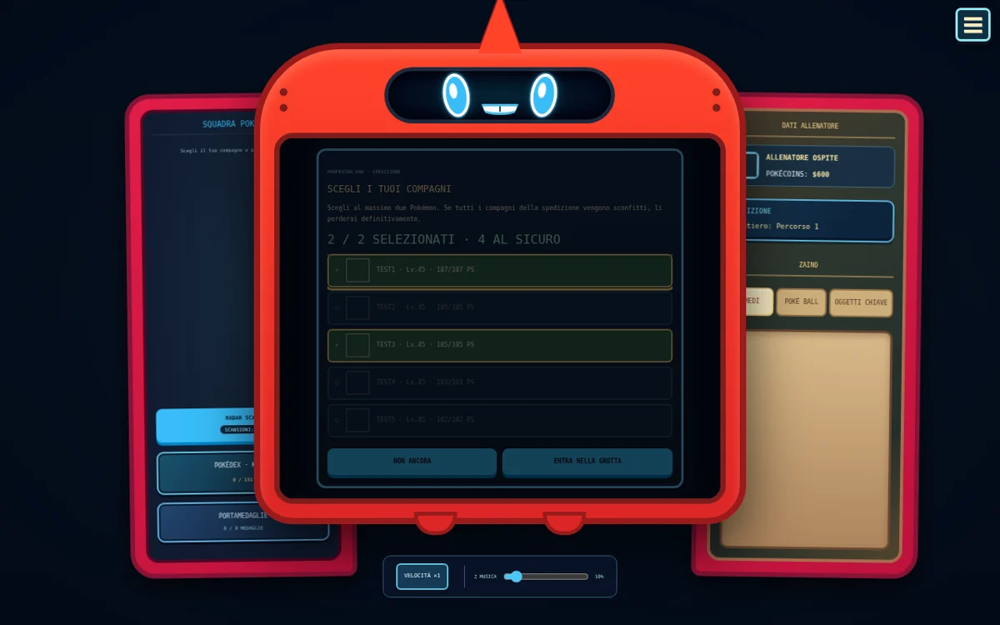
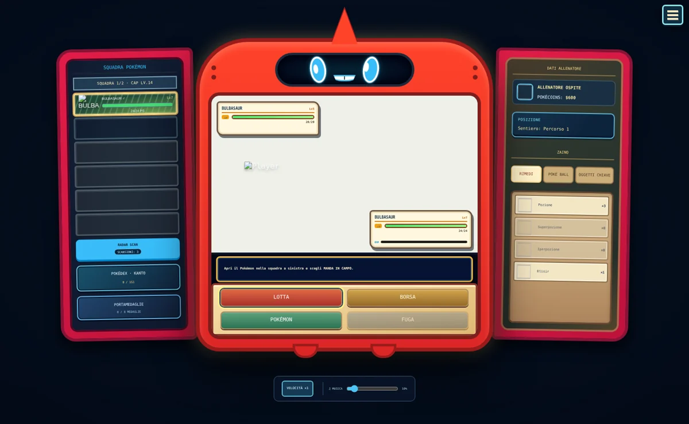
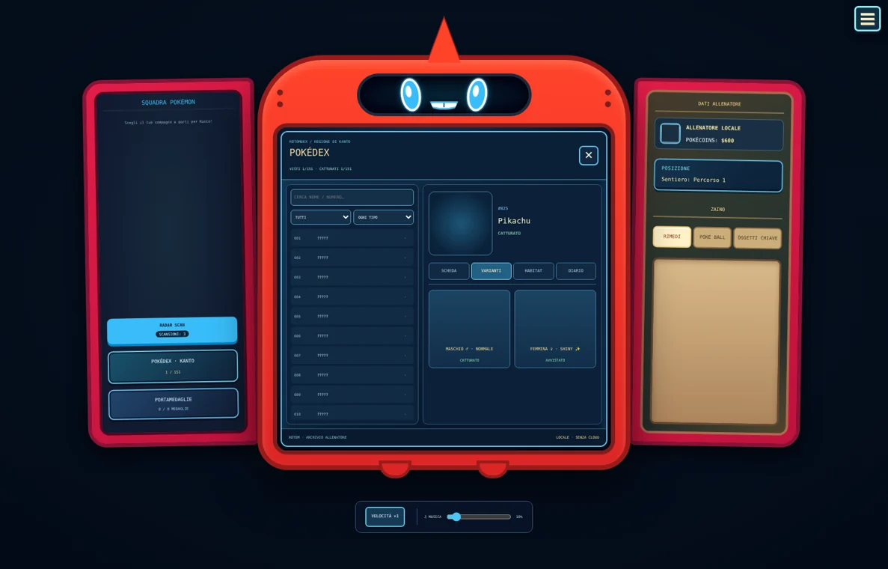

# 🎮 POKÉXPLORER

**Un’avventura Pokémon roguelike ambientata a Kanto**

*Esplora. Combatti. Cattura. Sopravvivi.*

**Pokéxplorer Beta Version** · **Lingua: Italiano** · **Gioco fan-made per browser**

[🎮 Gioca a Pokéxplorer](https://nicolcnt.github.io/pokexplorer/) · [💬 Entra nel server Discord](https://discord.gg/qNGscTEYHM) · [📂 Repository GitHub](https://github.com/nicolcnt/pokexplorer)

---

## 🌍 Benvenuto a Kanto

In **Pokéxplorer** ogni nuova avventura mette alla prova le tue decisioni: scegli il tuo Pokémon iniziale, attraversa sentieri, villaggi e dungeon, affronta allenatori e Capipalestra e prepara una squadra capace di arrivare fino alla sfida finale.

La fortuna conta, ma non basta. Le catture, la gestione degli oggetti e le scelte nei momenti difficili possono cambiare l'esito della run.

## ✨ Cosa ti aspetta

| 🕹️ | Caratteristica |
| :---: | --- |
| 🗺️ | **Esplorazione roguelike** attraverso 80 piani, con combattimenti ed eventi. |
| ⚔️ | **Lotte Pokémon** contro selvatici, allenatori, boss e Capipalestra. |
| 🎒 | **Gestione della squadra** fino a sei Pokémon, con oggetti, evoluzioni e abilità. |
| 📖 | **Pokédex di Kanto** con 151 specie e scoperte persistenti tra le avventure. |
| ✨ | **Pokémon shiny** con probabilità base di 1 su 2.000 per le generazioni casuali. |
| 🏅 | **Medaglie e 17 obiettivi** da completare nel corso delle tue run. |
| 🏆 | **Personaggio Campione** da sbloccare vincendo una run con un solo Pokémon, in entrambe le modalità. In modalità ospite vale per la sessione; sul profilo locale o Discord si conserva. |
| 🌌 | **Grotta Celeste**, una spedizione speciale in cui ogni scelta ha conseguenze. |

## 📸 Uno sguardo al gioco

### Battaglie e gestione dei Pokémon

### Pokédex e scoperte

*Le immagini mostrano schermate di sviluppo: l'interfaccia può cambiare con gli aggiornamenti.*

## 🪨 Novità: le pietre di Eevee

Al **piano 15** un'anziana offre **una sola pietra per run**: Pietraidrica,
Pietratuono o Pietrafocaia. Puoi accettare il regalo anche se non hai Eevee;
la pietra viene conservata in **Borsa → Rimedi**. Usala su Eevee per ottenere
rispettivamente Vaporeon, Jolteon o Flareon, senza requisito di livello.
La scelta viene confermata prima dell'evoluzione; dopo l'uso la pietra scompare.
Il regalo e il consumo sono salvati con il checkpoint esistente (locale/cloud).

La DEV MODE mostra temporaneamente il Pokédex completo, comprese le varianti shiny,
senza scrivere progressi sul profilo reale.

## 🎯 Come si gioca

1. Avvia una **Nuova Avventura** e scegli il protagonista e il compagno iniziale.
2. Esplora la mappa, affronta gli incontri e cerca nuovi Pokémon.
3. Usa **Poké Ball**, rimedi e abilità per far crescere la squadra.
4. Ottieni le medaglie e supera le sfide dei dungeon.
5. Prova a concludere la run e a completare gli **Obiettivi**.

**Comandi:** durante le battaglie puoi usare **WASD** o le **frecce** per spostare la selezione, **Spazio** per confermare ed **Esc** per tornare indietro quando possibile. I pulsanti sono utilizzabili anche con il mouse. Con **AUTO DIALOGHI**, nel piè di pagina, i dialoghi fuori dalle lotte avanzano da soli.

## 🧭 Scelte durante la run

- **Modalità**: *Nuzlocke* (i Pokémon esausti lasciano definitivamente la squadra) o *Normale* (restano in squadra e Joy può curarli al Centro Pokémon; se tutta la squadra è esausta Joy interviene sul posto, senza saltare piani). Gli obiettivi specifici sono indicati nel registro.
- **Bivi**: un dungeon con due uscite ogni cinque piani, a partire dal piano 3. L’uscita Facile porta a un percorso tranquillo, quella Difficile a una zona con più allenatori e ricompense.
- **Bivi**: alcuni percorsi hanno due uscite, ⚔ zona allenatori (più ricompense) o ☘ percorso tranquillo (più sicuro).

## 💾 Salvataggi e progressi

Il gioco salva da solo nei momenti sicuri dell'avventura e puoi usare **Salva partita** dal menu Opzioni.
Pokédex e Obiettivi restano associati al tuo account.

- **Le lotte contano sempre.** Lo stato della lotta viene registrato a ogni turno: ricaricare la pagina o tornare al menu non annulla danni, strumenti usati o Pokémon esausti. Una lotta interrotta è considerata abbandonata.
- **Game over significa fine della run.** Il salvataggio non viene cancellato, ma quella run non si può più continuare: si ricomincia con una nuova avventura.
- **Grotta Celeste.** Abbandonare la spedizione a metà equivale a una sconfitta: i Pokémon partiti non tornano.

Per i salvataggi persistenti è necessario l'accesso con **Discord**. La modalità **UTENTE**, senza accesso, serve per provare il gioco e **non conserva la partita**.

## 💬 Community

Novità, segnalazioni di bug, proposte e confronti tra giocatori si trovano nel server ufficiale:

**👉 [Unisciti al Discord di Pokéxplorer](https://discord.gg/qNGscTEYHM)**

## 👨‍💻 Crediti

**Creato e sviluppato da 17nico.** Pokéxplorer è un progetto indipendente, gratuito e senza pubblicità, realizzato per passione verso il mondo Pokémon e i roguelike.

Dati delle specie da [PokéAPI](https://pokeapi.co), sprite di mappa da [pret/pokefirered](https://github.com/pret/pokefirered), font *Press Start 2P* (SIL OFL). L'elenco completo è in [CREDITS.md](CREDITS.md).

## ⚖️ Avvertenze e diritti

**Pokéxplorer è un fan game non ufficiale e non commerciale.** Non è affiliato, sponsorizzato né approvato da Nintendo, Creatures Inc., GAME FREAK inc. o The Pokémon Company. Pokémon e i relativi nomi, personaggi e materiali sono © Nintendo / Creatures / GAME FREAK / The Pokémon Company.

La pubblicazione del repository non concede una licenza di riutilizzo del codice e dei materiali del progetto; per gli asset di terze parti valgono le condizioni dei rispettivi titolari (vedi [CREDITS.md](CREDITS.md)). Come vengono trattati i dati dell'accesso con Discord è spiegato in [privacy.html](privacy.html).

## 🛠️ Per sviluppatori

Per giocare in locale basta aprire `index.html`. Il codice sorgente è in `js/`: dopo una modifica esegui `npm run build`.
Struttura del codice in [docs/ARCHITETTURA.md](docs/ARCHITETTURA.md); test, dati e configurazione in [docs/SVILUPPO.md](docs/SVILUPPO.md); novità in [CHANGELOG.md](CHANGELOG.md).

---

**🌟 Ogni run è una storia diversa. La prossima sarà la tua?**

[💬 Discord ufficiale](https://discord.gg/qNGscTEYHM)

